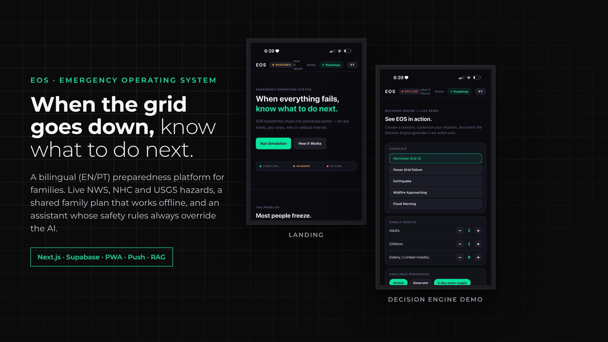
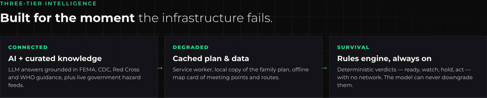

<p align="center">
  
</p>

<p align="center">
  <a href="https://eos-app-fawn.vercel.app"><b>Open the app</b></a> ·
  <a href="#what-eos-does">What it does</a> ·
  <a href="#built-for-the-moment-the-infrastructure-fails">Architecture</a> ·
  <a href="#for-developers">For developers</a>
</p>

---

## FOR IMMEDIATE RELEASE

# EOS, an Emergency Operating System for families, turns hurricane warnings and infrastructure failures into a clear, shared plan — online or off

**Developed in South Florida, the bilingual platform combines live government hazard data, a household-level preparedness model and an AI assistant whose safety rules always override the model.**

**PARKLAND, Fla. — October 2026 —** Paulo Libânio Neto, founder of BrightScale Contractor, today presented **EOS (Emergency Operating System)**, a bilingual English/Portuguese platform that helps a family decide what to do in the first hours of a hurricane, flood, earthquake or prolonged power outage — and keeps working when the network does not.

When infrastructure fails, families do not lack information; they drown in it. Alerts arrive from a dozen sources, nobody knows who picks up the kids, and supply lists don't account for who actually lives in the house. EOS was designed around one question: *what does this family need to do in the next 15 minutes?*

EOS reads live hazards from the **National Weather Service, the National Hurricane Center and the USGS**, along with rainfall, air quality and active **FEMA shelters**, and places them on a map next to the family's home. It then measures the household against the threat: water and food are summed across everyone who lives at the address and divided by the real number of people — so the app counts the *house*, not one account.

Families build a **shared plan** together — meeting points, hand-drawn routes, roles and triggers, and who picks up whom, including children and elderly relatives who have no phone. The plan is stored on the device and can be opened as an offline map card with no signal.

The built-in assistant, **Pilot**, answers in plain language using a curated knowledge base of FEMA, Red Cross, CDC and WHO guidance. Its verdict — *ready, watch, hold* or *act* — comes from a deterministic rules engine, not from the language model, and the model is never allowed to downgrade it. If EOS can't read the household's situation, the answer is "wait," never "you're fine."

> "Infrastructure is my profession — I renovate the buildings people live in. Storm season in Florida taught me that the hardest part of an emergency is the first decisions, made by tired people with a dead network. EOS gives a family one plan, the same numbers on every screen, and an assistant that will not reassure you without a reason."
> — **Paulo Libânio Neto**, founder

EOS runs today as an installable web app with push notifications, family "circles" with roles and invitations, and paid Family and Premium plans. Native iOS and Android shells are in preparation for the app stores.

---

## What EOS does

| Area | Capabilities |
|---|---|
| **Live hazards** | NWS severe alerts · NHC hurricanes · USGS earthquakes · rainfall and air quality · active FEMA shelters · map layers for radar, wind, cyclone, flood, storm surge and tornado |
| **The household** | Emergency profile with medical notes and a QR code for first responders · dependents with medications and mobility needs · shared pantry across people who live together · consent kept separate from medical data |
| **The family plan** | Meeting points, hand-drawn routes, roles, triggers, "who picks up whom" · warnings when someone would be left behind · offline plan card |
| **Pilot assistant** | Plain-language answers grounded in FEMA, Red Cross, CDC and WHO material · deterministic verdict that the AI cannot override · works locally without network |
| **Circles** | Admin / Editor / Viewer roles · invite by link or QR · approval requests · optional live location sharing |
| **Training** | Shared scenario simulations with a debrief against the family's real plan |
| **Business** | Stripe subscriptions (Family, Premium) · affiliate and gift codes · bilingual EN / PT-BR |

## Built for the moment the infrastructure fails



EOS runs as a **fallback chain**, not a feature toggle. The rules engine always runs first; the language model can add explanation but never lower the urgency.

| Mode | When | What runs |
|---|---|---|
| **Connected** | Internet available | LLM + retrieval over the curated knowledge base, live hazard feeds |
| **Degraded** | Weak or intermittent signal | Service worker, cached plan and data, offline plan card |
| **Survival** | Always | Deterministic rules engine — instant, no network |

## Engineering at a glance

- **34 screens, 70 API routes, 37 database tables** (inventory of August 2026)
- **Automated tests:** browser tests run against the production database plus unit suites with 200+ tests; every marketing claim is traced to a test in [`docs/33-inventario-de-verdade.md`](docs/33-inventario-de-verdade.md)
- **140+ roadmap tasks delivered**, with decisions logged in [`docs/08-decisions-log.md`](docs/08-decisions-log.md)
- Privacy by design: location, health and children's data mapped field by field for store review

## Roadmap

- **Native apps** for iOS and Android (shells built; store submission in progress)
- **On-device AI** so Pilot can reason with no server at all
- **Off-grid messaging** between family devices over LoRa mesh radios
- **CarPlay / Android Auto** evacuation mode

## Tech stack

Next.js 14 (App Router) · TypeScript · Supabase (Postgres, Auth, pgvector) · Vercel (hosting and cron) · MapLibre · Web Push (VAPID) · Stripe · OpenAI and Anthropic APIs · PWA with service worker

---

## For developers

```bash
npm install
cp .env.example .env.local   # fill in the values below
npm run dev
```

**Required:** `NEXT_PUBLIC_SUPABASE_URL`, `NEXT_PUBLIC_SUPABASE_ANON_KEY`, `SUPABASE_SERVICE_ROLE_KEY`, `NEXT_PUBLIC_SITE_URL`, `OPENAI_API_KEY`
**Optional:** `OPENAI_MODEL`, `CRON_SECRET`, `STRIPE_*`, `SENTRY_DSN`, and weather provider keys (WeatherKit, AccuWeather, Xweather) — see `.env.example`.

Product documentation lives in [`docs/`](docs/) — vision, MVP scope, data model, decisions log, build status and the feature inventory.

## Contact

Paulo Libânio Neto · contact@brightscalegroup.com · [github.com/libanius](https://github.com/libanius)
